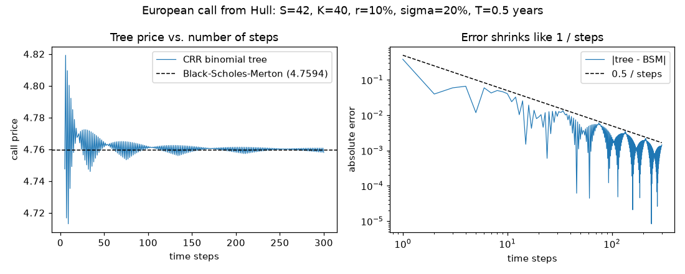
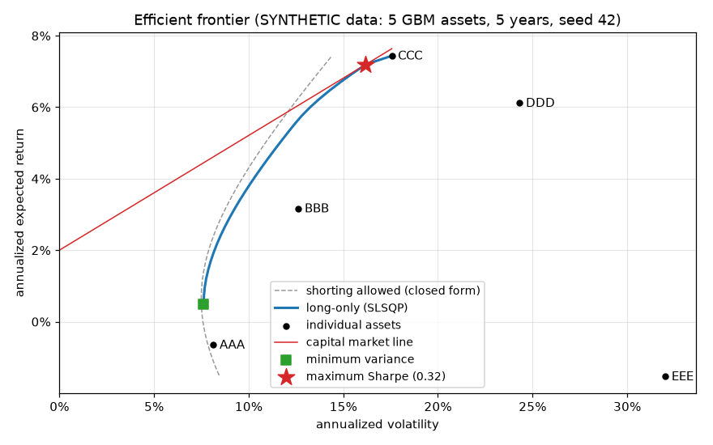
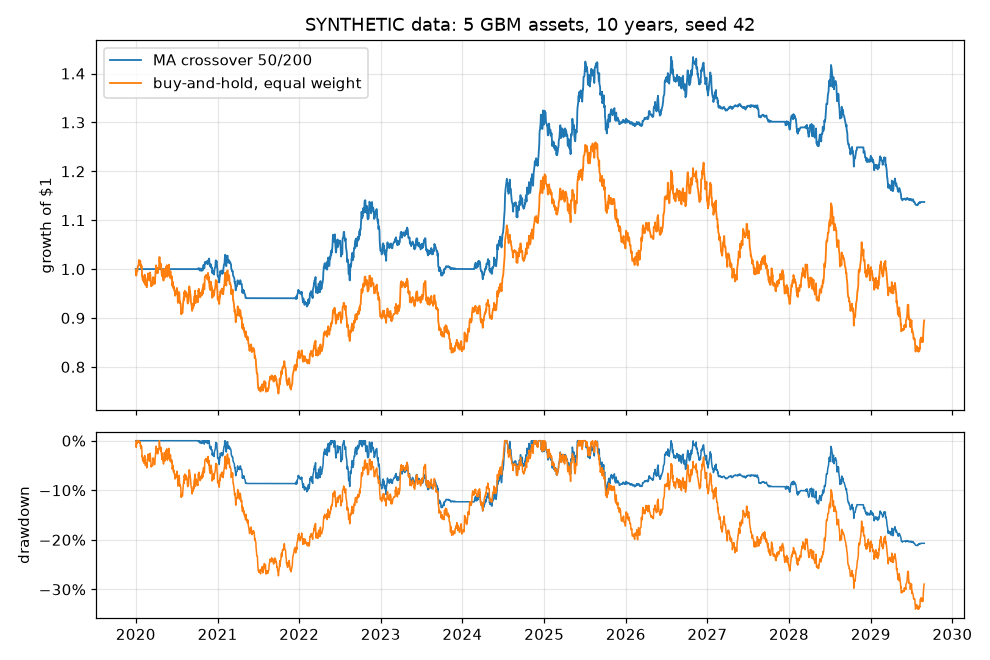
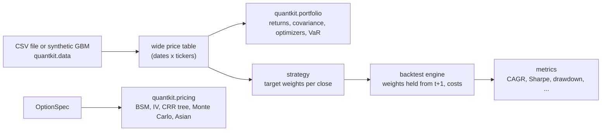

# quantkit

Options pricing, portfolio optimization and backtesting in Python — every model checked against closed-form results, textbook values or an independent method.

[](https://github.com/ult666666/quantkit/actions/workflows/ci.yml)
[](LICENSE)
[](pyproject.toml)

> **Note:** quantkit is educational and research software. It is not investment advice, and nothing in this repository is a recommendation to buy or sell anything.

## Why

Quantitative finance code fails quietly: a sign slip in a Greek, an off-by-one day in a backtest or an optimizer that stops early all still return plausible-looking numbers. quantkit is a small, readable library built around verification. Each model is tested against something it did not produce itself: a textbook value, a closed-form solution, an independent implementation, or an identity that must hold. The backtester has an explicit, tested no-look-ahead contract.

## Features

- **Option pricing** (`quantkit.pricing`)
  - Black–Scholes–Merton prices and analytic Greeks (delta, gamma, vega, theta, rho) with a continuous dividend yield, on a validated, frozen `OptionSpec` dataclass.
  - Implied volatility with Brent's method, raising a typed `ArbitrageBoundError` when a price violates the no-arbitrage bounds.
  - Cox–Ross–Rubinstein binomial tree for European and American (early-exercise) options.
  - Monte Carlo under geometric Brownian motion with antithetic variates, standard errors and 95% confidence intervals, reproducible from a seed.
  - Arithmetic-average Asian options by Monte Carlo, with the geometric-average closed form as a control variate.
- **Portfolio construction** (`quantkit.portfolio`)
  - Simple and log returns; annualized sample covariance and Ledoit–Wolf shrinkage.
  - Minimum-variance, maximum-Sharpe and target-return portfolios with weight bounds (SciPy SLSQP), closed-form solutions for the unbounded case, and efficient frontiers.
  - Equal-risk-contribution (risk parity) and custom risk-budget portfolios.
  - Volatility, historical and Gaussian VaR and CVaR (expected shortfall).
- **Backtesting** (`quantkit.backtest`)
  - Daily vectorized engine: weights decided at the close of day *t* are held from day *t*+1, with drift-aware turnover and proportional costs in basis points.
  - Strategies: buy-and-hold, periodically rebalanced equal weight, moving-average crossover, time-series momentum and inverse volatility.
  - Metrics: CAGR, volatility, Sharpe, Sortino, maximum drawdown and its duration, Calmar, hit rate and turnover, plus a look-ahead checker for custom strategies.
- **Data** (`quantkit.data`): a seeded correlated-GBM price simulator and a validating CSV loader (long or wide format).
- **CLI**: `quantkit price | iv | simulate | backtest | frontier`.
- Fully typed (`mypy --strict`, ships `py.typed`) and linted with ruff; the CI workflow targets Python 3.11–3.13.

## Quick start

quantkit is not on PyPI. Install the library and the `quantkit` CLI from the GitHub release (Python 3.11+):

```bash
pip install https://github.com/ult666666/quantkit/releases/download/v0.1.0/quantkit-0.1.0-py3-none-any.whl
```

Each release also attaches the source distribution and SHA-256 checksums. To work on the code, install it from source with [uv](https://docs.astral.sh/uv/):

```bash
git clone https://github.com/ult666666/quantkit.git
cd quantkit
uv sync                 # creates .venv with quantkit and the development tools
uv run quantkit --help
```

Or, with pip inside a virtual environment: `pip install .` (or `pip install ".[plot]"` for charts).

Price Hull's textbook option four ways. The outputs shown here are checked as doctests by the test suite:

```python
>>> from quantkit.pricing import (
...     OptionSpec, binomial_price, bsm_greeks, bsm_price, implied_vol, monte_carlo_price,
... )
>>> call = OptionSpec(spot=42, strike=40, rate=0.10, vol=0.20, maturity=0.5, kind="call")
>>> round(bsm_price(call), 4)
4.7594
>>> g = bsm_greeks(call)
>>> print(f"delta={g.delta:.4f} gamma={g.gamma:.4f} vega={g.vega:.4f} theta={g.theta:.4f}")
delta=0.7791 gamma=0.0500 vega=8.8134 theta=-4.5591
>>> round(implied_vol(4.76, spot=42, strike=40, rate=0.10, maturity=0.5, kind="call"), 4)
0.2001
>>> mc = monte_carlo_price(call, n_paths=200_000, seed=7)
>>> print(f"{mc.price:.4f} +/- {mc.std_error:.4f}, 95% CI [{mc.ci_low:.4f}, {mc.ci_high:.4f}]")
4.7547 +/- 0.0055, 95% CI [4.7440, 4.7654]
>>> put = OptionSpec(spot=50, strike=50, rate=0.10, vol=0.40, maturity=5 / 12, kind="put")
>>> round(binomial_price(put, steps=500, exercise="american"), 3)  # Hull reports 4.283
4.283

```

Build portfolios from (here, synthetic) prices and backtest a strategy:

```python
>>> from quantkit.data import simulate_gbm_prices
>>> from quantkit.portfolio import (
...     annualized_mean_returns, compute_returns, ledoit_wolf_covariance, max_sharpe,
...     risk_contributions, risk_parity,
... )
>>> prices = simulate_gbm_prices(  # synthetic: 5 years of correlated GBM
...     tickers=["AAA", "BBB", "CCC"], n_days=1260, drift=[0.04, 0.06, 0.08],
...     vol=[0.10, 0.15, 0.25], correlation=0.3, seed=1,
... )
>>> returns = compute_returns(prices)
>>> cov = ledoit_wolf_covariance(returns)
>>> weights = risk_parity(cov)
>>> weights.round(3).to_dict()
{'AAA': 0.47, 'BBB': 0.331, 'CCC': 0.199}
>>> risk_contributions(weights, cov).round(4).to_dict()
{'AAA': 0.3333, 'BBB': 0.3333, 'CCC': 0.3333}
>>> max_sharpe(annualized_mean_returns(returns), cov, risk_free_rate=0.02).round(3).to_dict()
{'AAA': 0.529, 'BBB': 0.471, 'CCC': 0.0}
>>> from quantkit.backtest import MovingAverageCrossover, run_backtest
>>> result = run_backtest(prices, MovingAverageCrossover(fast=50, slow=200), cost_bps=10)
>>> s = result.summary()
>>> print(f"CAGR {s['cagr']:.2%}, Sharpe {s['sharpe']:.2f}, max drawdown {s['max_drawdown']:.1%}")
CAGR 0.36%, Sharpe 0.08, max drawdown 14.9%

```

The maximum-Sharpe portfolio leaves out `CCC` because its *estimated* mean return over this sample is negative (−10.9% a year), even though it was simulated with a +8% drift: five years of data pin down expected returns very poorly. That estimation error, not the optimizer, is the main weakness of mean–variance optimization in practice.

## Usage

### Command line

Price an option with all three methods and print the Greeks:

```console
$ uv run quantkit price --spot 42 --strike 40 --rate 0.10 --vol 0.20 --maturity 0.5
European call: S=42 K=40 T=0.5 r=0.1 q=0 sigma=0.2

method                                 price   std. error
Black-Scholes-Merton                  4.7594
CRR binomial (500 steps)              4.7593
Monte Carlo (100,000 paths)           4.7659       0.0078

Greeks (Black-Scholes-Merton)
delta     0.7791
gamma     0.0500
vega      8.8134   per 1.00 change in volatility
theta    -4.5591   per year
rho      13.9820   per 1.00 change in the rate
```

American options use the binomial tree:

```console
$ uv run quantkit price --spot 50 --strike 50 --rate 0.10 --vol 0.40 --maturity 0.4167 --kind put --american
American put: S=50 K=50 T=0.4167 r=0.1 q=0 sigma=0.4

method                                     price
CRR binomial, American (500 steps)        4.2832
CRR binomial, European (500 steps)        4.0736
Black-Scholes-Merton, European            4.0761
early-exercise premium                    0.2096
```

The premium compares two trees with the same number of steps, so the tree's own discretization error cancels out.

Implied volatility, and the error for a price that no volatility can produce:

```console
$ uv run quantkit iv --price 4.76 --spot 42 --strike 40 --rate 0.10 --maturity 0.5
implied volatility: 0.200066 (20.01%)
$ uv run quantkit iv --price 1.50 --spot 42 --strike 40 --rate 0.10 --maturity 0.5
quantkit: error: price 1.5 is outside the no-arbitrage bounds (3.95082, 42); no volatility reproduces it
```

Backtests and frontiers read a CSV of daily closes, either long (`date,ticker,close`) or wide (`date` plus one column per ticker). To try them without real data, generate a **synthetic** file (five correlated GBM assets `AAA`–`EEE`, seed 42):

```console
$ uv run quantkit simulate --output prices.csv
wrote 1260 days x 5 tickers of synthetic GBM prices to prices.csv
$ uv run quantkit backtest prices.csv --strategy ma-crossover --cost-bps 10
5 assets, 1260 days (2020-01-01 to 2024-10-29), costs 10 bps of traded notional

                           ma-crossover (50/200) buy-and-hold (equal weight)
total return                               16.7%                        6.1%
CAGR                                       3.14%                       1.18%
volatility                                 8.22%                      11.92%
Sharpe                                      0.42                        0.16
Sortino                                     0.61                        0.22
max drawdown                               14.2%                       27.3%
max drawdown length (days)                   446                        1101
Calmar                                      0.22                        0.04
hit rate                                   50.9%                       51.8%
annual turnover                            1.31x                       0.20x
```

The crossover "wins" on this one synthetic history, but GBM has no trends to follow; the backtest example below shows why a single backtest proves little. Other strategies: `--strategy buy-and-hold | equal-weight | momentum | inverse-vol` (see `quantkit backtest --help`).

```console
$ uv run quantkit frontier prices.csv --shrinkage --risk-free 0.02
1259 daily returns of 5 assets; expected returns = annualized historical means, Ledoit-Wolf covariance; weights in [0, 1]; risk-free rate 2.00%

             return volatility Sharpe   AAA   BBB    CCC   DDD  EEE
1              0.5%       7.6%  -0.20 75.7% 19.1%   5.2%  0.0% 0.0%
2              1.5%       7.9%  -0.06 60.7% 24.1%  14.5%  0.6% 0.0%
3              2.5%       8.6%   0.06 45.9% 28.0%  22.6%  3.4% 0.0%
4              3.5%       9.6%   0.15 31.1% 32.0%  30.7%  6.2% 0.0%
5              4.5%      10.9%   0.23 16.3% 35.9%  38.8%  9.0% 0.0%
6              5.5%      12.3%   0.28  1.5% 39.8%  46.8% 11.8% 0.0%
7              6.4%      14.2%   0.31  0.0% 18.3%  65.8% 16.0% 0.0%
8              7.4%      17.6%   0.31  0.0%  0.0% 100.0%  0.0% 0.0%
min variance   0.5%       7.6%  -0.20 75.7% 19.1%   5.2%  0.0% 0.0%
max Sharpe     7.2%      16.2%   0.32  0.0%  0.0%  81.7% 18.3% 0.0%
```

Add `--plot frontier.png` to also save a chart (needs the `plot` extra), and, for example, `--min-weight -0.2 --max-weight 0.6` to change the weight bounds.

### Examples and figures

The scripts in [`examples/`](examples) regenerate every figure below (`uv run python examples/<name>.py`).

**Binomial convergence** ([`binomial_convergence.py`](examples/binomial_convergence.py)). CRR tree prices for Hull's call approach the Black–Scholes–Merton value with an error that shrinks like 1/steps, oscillating as tree nodes move relative to the strike.



**Efficient frontier** ([`efficient_frontier.py`](examples/efficient_frontier.py)), on **synthetic** data: the long-only frontier from SLSQP, the unconstrained frontier from its closed form (always to the left, since removing constraints can only lower risk), the minimum-variance and maximum-Sharpe portfolios and the capital market line. The means are estimated from five years of simulated prices, so `EEE`, simulated with an 11% drift, shows a negative estimated return.



**Backtest** ([`backtest_trend.py`](examples/backtest_trend.py)), on **synthetic** data: a 50/200-day moving-average crossover against equal-weight buy-and-hold over ten years, with 10 bps costs. On this history (seed 42) the crossover ends ahead. The script then repeats the comparison on 100 independent synthetic histories:

```text
over 100 independent synthetic histories, CAGR(MA) - CAGR(buy-and-hold): mean -3.41%, standard error 0.29%; MA crossover came out ahead in 14 of 100
```

Seed 42 happens to be one of the 14. With no trends in the data, the crossover mostly sits in cash while the assets drift upward.



## How it works



- **Pricing.** Every pricer takes the same frozen, validated `OptionSpec`, so one contract can be priced by independent methods and the results compared. The normal CDF is computed with `erfc`, which stays accurate deep in the tails. Implied volatility checks the model-free bounds first and then runs Brent's method, which cannot diverge the way Newton's method can when vega is tiny. The CRR tree rolls values back one vectorized level at a time; Monte Carlo samples the terminal price exactly, so its only error is sampling error.
- **Portfolio.** Optimizers use SLSQP so that weight bounds are easy to add, and the unbounded problems also have closed forms that serve as a reference in the tests. The maximum-Sharpe problem is solved through a change of variables that turns it into a convex quadratic program. Risk parity minimizes a convex log-barrier objective (Maillard, Roncalli & Teïletche 2010) by cyclical coordinate descent.
- **Backtest.** The timing contract is explicit:

  | At the close of day *t* | During day *t*+1 |
  | --- | --- |
  | The strategy sees prices for days 0..*t* and returns target weights (or NaN for "no trade"). The portfolio trades to those weights at that close and pays `cost_bps` on the traded notional. | The new weights earn day *t*+1's return. Between trades, weights drift with prices. |

  The engine is vectorized: between trades the share counts are constant, so each day's weights follow from the weights at the last trade and the price growth since then.

[docs/DESIGN.md](docs/DESIGN.md) explains the architecture, the main design decisions and their trade-offs in more detail.

## Correctness

| Component | Checked against |
| --- | --- |
| BSM prices | Hull's textbook values (call ≈ 4.76, put ≈ 0.81); put–call parity and no-arbitrage bounds over random inputs (Hypothesis) |
| BSM Greeks | Hull's Greek-letters example; central finite differences; call–put Greek identities |
| Implied volatility | Round trips through BSM over random inputs; typed errors for prices outside the bounds |
| Binomial tree | Convergence to BSM at rate 1/steps; Hull's American put values for 5, 30, 50, 100 and 500 steps; a one-step tree by hand; American put ≥ European put; American call = European call when q = 0 |
| Monte Carlo | Within 3 standard errors of BSM; 95% intervals contain the BSM price in 92–98% of 400 seeded runs; antithetic variates lower the standard error |
| Asian options | Geometric formula equals BSM with one fixing and matches an independent simulation; the control-variate estimate agrees with plain Monte Carlo at over 10x lower standard error |
| Ledoit–Wolf | scikit-learn's `ledoit_wolf`, including more assets than observations |
| Mean–variance | Closed-form minimum-variance, tangency and target-return portfolios (unbounded case); first-order conditions; no random feasible portfolio beats the optimizer; budget and bounds respected |
| Risk parity | Equal risk contributions; inverse-volatility closed forms (uncorrelated or two assets); volatility between minimum-variance and 1/N |
| VaR / CVaR | Hand-computed tails; Gaussian closed forms; historical converges to parametric on normal data |
| Backtester | An independent day-by-day reference loop; buy-and-hold equals the asset return; costs reduce wealth by exactly the computed amount; a hand-computed two-day example; **no look-ahead**: perturbing prices after day *t* leaves every weight in effect through day *t*+1 unchanged, and a deliberately cheating strategy fails the same check |
| Metrics | Hand-computed series (drawdown and its duration, CAGR, Sharpe, Sortino, Calmar, hit rate) |
| Data | Simulated means, volatilities and correlations match their targets; CSV round trips and specific error messages |

Monte Carlo and other statistical tests use fixed seeds, so they cannot fail by chance; the Hypothesis property tests draw fresh random inputs on every run (200 per test, or 5,000 with `pytest --hypothesis-profile=thorough`). The CI workflow runs ruff, `mypy --strict`, the tests with a 90% coverage floor, the README doctests and CLI smoke tests on Python 3.11, 3.12 and 3.13.

## Development

```bash
uv sync                                   # runtime + dev dependencies (pytest, hypothesis, mypy, ruff, ...)
uv run ruff check .                       # lint
uv run ruff format --check .              # formatting
uv run mypy                               # strict type checking of src, tests and examples
uv run pytest --cov=quantkit              # unit tests, Hypothesis properties and README doctests
uv run python examples/backtest_trend.py  # regenerate a figure in docs/images
```

## Limitations and roadmap

**Models.** Black–Scholes–Merton and GBM assume constant volatility and rates, lognormal prices and continuous dividends: no volatility smile, jumps or discrete dividends. Monte Carlo covers European and Asian payoffs only (no Longstaff–Schwartz for American options). The CRR tree converges slowly and with oscillation; smoother trees such as Leisen–Reimer are not implemented. Implied volatilities outside 0.0001%–1000% are reported as errors. The pricing API is scalar; large option chains would call for a vectorized interface.

**Portfolio.** Expected returns are plain historical means, which are very noisy. The same weight bounds apply to every asset, with no per-asset, sector or turnover constraints. SLSQP is a general-purpose solver that works well for tens of assets; a dedicated QP solver would scale better. Risk parity is long-only. VaR is one-period and in return units.

**Backtesting.** Daily close-to-close only: trades fill at the same close that produced the signal, and the only friction is a proportional cost (no slippage, market impact, borrowing or financing costs). Idle cash earns nothing. Prices must be complete (no missing values and no assets entering mid-sample) and should already be adjusted for splits and dividends. The no-look-ahead guarantee covers the engine and the built-in strategies; custom strategies can be checked with `check_no_lookahead`.

**Data and verification.** There is deliberately no data downloader: bring your own CSV with ISO dates. CI runs lint, strict type checks and the full suite with README doctests on Python 3.11, 3.12 and 3.13. The 3.11 job installs NumPy 2.4 and older pandas type stubs; it caught three type annotations those stubs read differently, which were fixed in the source.

**Roadmap ideas:** per-asset and linear constraints, a vectorized BSM interface, Longstaff–Schwartz for American options, Black–Litterman expected returns, and walk-forward evaluation with execution lag in the backtester.

## References

- Hull, J. C. *Options, Futures, and Other Derivatives*. Pearson (chapters on the Black–Scholes–Merton model, the Greek letters, binomial trees and numerical procedures).
- Black, F. & Scholes, M. (1973). The pricing of options and corporate liabilities. *Journal of Political Economy*, 81(3), 637–654.
- Merton, R. C. (1973). Theory of rational option pricing. *Bell Journal of Economics and Management Science*, 4(1), 141–183.
- Cox, J. C., Ross, S. A. & Rubinstein, M. (1979). Option pricing: A simplified approach. *Journal of Financial Economics*, 7(3), 229–263.
- Glasserman, P. (2003). *Monte Carlo Methods in Financial Engineering*. Springer.
- Kemna, A. G. Z. & Vorst, A. C. F. (1990). A pricing method for options based on average asset values. *Journal of Banking & Finance*, 14(1), 113–129.
- Markowitz, H. (1952). Portfolio selection. *Journal of Finance*, 7(1), 77–91.
- Merton, R. C. (1972). An analytic derivation of the efficient portfolio frontier. *Journal of Financial and Quantitative Analysis*, 7(4), 1851–1872.
- Cornuéjols, G. & Tütüncü, R. (2007). *Optimization Methods in Finance*. Cambridge University Press.
- Ledoit, O. & Wolf, M. (2004). A well-conditioned estimator for large-dimensional covariance matrices. *Journal of Multivariate Analysis*, 88(2), 365–411.
- Maillard, S., Roncalli, T. & Teïletche, J. (2010). The properties of equally weighted risk contribution portfolios. *Journal of Portfolio Management*, 36(4), 60–70.
- Griveau-Billion, T., Richard, J.-C. & Roncalli, T. (2013). A fast algorithm for computing high-dimensional risk parity portfolios. arXiv:1311.4057.
- Moskowitz, T. J., Ooi, Y. H. & Pedersen, L. H. (2012). Time series momentum. *Journal of Financial Economics*, 104(2), 228–250.

## License

[MIT](LICENSE) © 2026 Charles Dai
