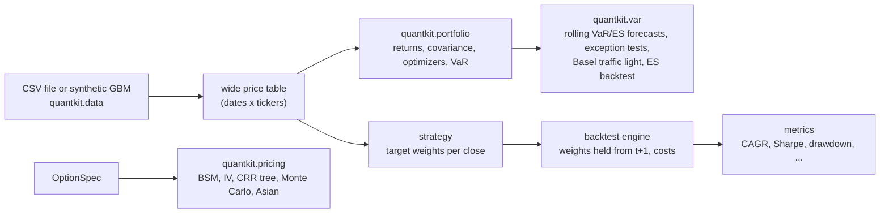

# quantkit design notes

This document explains how quantkit is put together, why it is built that way, and how its correctness is checked. It is meant to be read alongside the code: each section names the module it describes.

## 1. Goals and non-goals

**Goals**

- Implement the standard models of an introductory quantitative finance course (option pricing, mean–variance and risk-parity portfolios, backtesting) and the standard way risk teams validate a VaR model, in code that a reader can follow line by line.
- Verify every model against something it did not produce itself: a textbook value, a closed form, an independent implementation, or an identity.
- Fail loudly: validate inputs at the public boundary and raise typed errors with messages that name the problem.

**Non-goals**

- Speed at scale. The pricing API is scalar, the optimizers use a general-purpose solver, and the backtester is daily. These trade-offs keep the code readable.
- Market data. There is no downloader; users bring a CSV, and examples use clearly labelled synthetic data.
- Production trading features: order management, execution simulation, intraday data, corporate actions.

## 2. Architecture

```text
src/quantkit/
├── exceptions.py        QuantkitError → InvalidParameterError (ValueError) → ArbitrageBoundError, DataValidationError
│                        QuantkitError → ConvergenceError (RuntimeError)
├── _validation.py       shared argument checks and type aliases (FloatArray, SeedLike)
├── pricing/             option.py (OptionSpec) · black_scholes.py · implied_vol.py · binomial.py
│                        monte_carlo.py · asian.py
├── portfolio/           estimators.py · mean_variance.py · risk_parity.py · risk.py
├── backtest/            engine.py · strategies.py · metrics.py
├── var/                 forecasts.py · backtests.py · traffic_light.py · es_backtest.py
├── data.py              synthetic GBM prices, CSV loader
└── cli.py, __main__.py  argparse front end (`quantkit ...`, `python -m quantkit`)
```

Data flows through the subpackages like this:



Dependencies point one way: `pricing`, `portfolio`, `backtest` and `var` depend only on `_validation` and `exceptions` (and `backtest.engine` on `backtest.metrics`; inside `var`, `forecasts` uses `backtests` and `es_backtest` uses `forecasts`); `data` depends on `_validation`; only `cli` depends on everything, and only `__main__` imports `cli`. This keeps each subpackage testable on its own. The tail size shared by historical VaR and rolling historical simulation, `ceil(n (1 - level))`, lives in `_validation.tail_count` so that the two cannot drift apart.

**Conventions used everywhere**

| Quantity | Convention |
| --- | --- |
| Rates, yields, volatilities, returns | Decimals (`0.05` = 5%), annualized unless the name says otherwise |
| Time | Years for option maturities; trading days (252 per year) for price series |
| Price tables | Wide `DataFrame`: sorted `DatetimeIndex` named `date`, one column per ticker, no missing values |
| Weights | `pandas.Series` indexed by ticker; inputs are aligned by label, never by position |
| Greeks | Exact partial derivatives: vega per 1.00 of volatility, theta per year, rho per 1.00 of rate |
| Risk numbers | VaR, CVaR and maximum drawdown are positive loss fractions |

**Errors.** Every deliberate error derives from `QuantkitError`. Bad inputs also derive from `ValueError` and solver failures from `RuntimeError`, so callers can use either the library's or the standard library's hierarchy. `ArbitrageBoundError` carries the offending price and both bounds as attributes.

## 3. Option pricing (`quantkit.pricing`)

### `OptionSpec`

A frozen, keyword-only, slotted dataclass holding the contract (strike, maturity, call/put) and the market (spot, rate, volatility, dividend yield). Keyword-only fields make `OptionSpec(spot=42, strike=40, ...)` impossible to transpose by accident; `frozen=True` makes specs hashable and safe to share; `dataclasses.replace(option, vol=0.25)` derives bumped copies, which is how the finite-difference tests work. `__post_init__` validates every field and stores plain floats, so NumPy scalars do not leak into reprs. Exercise style is an argument of the pricer, not a field, because the same contract is priced as European by BSM and as either style by the tree.

**Trade-off:** scalar inputs keep formulas readable but make pricing a large option chain a Python loop. A vectorized interface is on the roadmap.

### Black–Scholes–Merton (`black_scholes.py`)

$$c = S e^{-qT} N(d_1) - K e^{-rT} N(d_2), \qquad p = K e^{-rT} N(-d_2) - S e^{-qT} N(-d_1)$$

$$d_1 = \frac{\ln(S/K) + (r - q + \sigma^2/2)T}{\sigma\sqrt{T}}, \qquad d_2 = d_1 - \sigma\sqrt{T}$$

- `norm_cdf(x) = 0.5 * erfc(-x / sqrt(2))`. The textbook `0.5 * (1 + erf(x / sqrt(2)))` subtracts two nearly equal numbers for very negative `x` and returns 0 for deep out-of-the-money options; `erfc` keeps full relative precision. The test suite compares it with SciPy's `ndtr` down to `x = -37`.
- The Greeks are the analytic derivatives (Hull's formulas with a dividend yield), with `theta = -dV/dT` (calendar-time decay, per year).

### Implied volatility (`implied_vol.py`)

1. Compute the model-free bounds `max(PV(S) - PV(K), 0) < call < PV(S)` (and the put analogue). A price outside them admits a static arbitrage, and no volatility can produce it, so `ArbitrageBoundError` is raised before any solving.
2. Inside the bounds, `f(sigma) = BSM(sigma) - price` is continuous and strictly increasing (vega > 0), so it has exactly one root.
3. Solve with Brent's method on `[1e-6, 10]`. Brent keeps the root bracketed at every step, so it cannot diverge. Newton's method converges faster near the root but can overshoot wildly when vega is tiny (deep in or out of the money).
4. If the root lies outside the interval (the price sits numerically on a bound), raise `ConvergenceError` instead of returning a misleading endpoint.

### Cox–Ross–Rubinstein tree (`binomial.py`)

- `u = exp(sigma sqrt(dt))`, `d = 1/u`, `p = (exp((r - q) dt) - d) / (u - d)`. If `p` is not in (0, 1), the tree is not arbitrage-free (the drift over one step exceeds an up-move), so the function raises and suggests more steps.
- Node prices are computed as `S * exp(log_u * (2j - i))` rather than `S * u**j * d**(i-j)`, which avoids overflow and round-off for large trees.
- Backward induction is vectorized per level: `V_i = disc * (p * V_{i+1}[1:] + (1-p) * V_{i+1}[:-1])`. Total cost is O(N²) time and O(N) memory: a few milliseconds for 1,000 steps on a laptop.
- **American exercise** replaces each node value with `max(continuation, exercise value)`.
- **Convergence** to BSM is O(1/N) but not monotone: the error oscillates as nodes move relative to the strike. The tests therefore compare the *worst* error over windows of consecutive step counts, rather than assuming the error falls at every step.
- **American call = European call when q = 0 and r ≥ 0** (Merton 1973): the call is worth at least `S - K e^{-r(T-t)} ≥ S - K` alive, so early exercise never helps. The tree reproduces this to 1e-12; with `r < 0` or `q > 0` the result does not hold, and the tests include a high-dividend case where the American call is worth more.

### Monte Carlo (`monte_carlo.py`)

- GBM has the exact solution `S_T = S exp((r - q - sigma²/2) T + sigma sqrt(T) Z)`, so a European payoff needs one normal draw per path and has no discretization error, only sampling error.
- **Antithetic variates** pair each `Z` with `-Z`. A call or put payoff is monotone in `Z`, so the two halves of a pair are negatively correlated and their average has lower variance than two independent draws. The standard error is computed from the pair averages (which are i.i.d.), not from the 2n correlated payoffs; using the latter would understate the error.
- The 95% interval is `price ± 1.96 SE` (central limit theorem). A test runs 400 seeds and checks that the interval covers the BSM price in 92–98% of runs, a direct check that the standard error is right.
- Randomness comes from `numpy.random.default_rng(seed)`; nothing touches global random state.

### Asian options (`asian.py`)

The geometric average `G` of lognormal prices is lognormal. With `n` equally spaced fixings, `ln G` has mean `ln S + (r - q - sigma²/2) T (n+1)/(2n)` and variance `sigma² T (n+1)(2n+1)/(6n²)`, which gives a Black–Scholes-type formula (Kemna & Vorst 1990). With `n = 1` the formula reduces to BSM, which the tests check to 1e-12.

The arithmetic option has no closed form. The Monte Carlo estimator subtracts the geometric payoff's simulation error, whose mean is known: `Y_cv = Y - b (X - E[X])` with `b = Cov(Y, X) / Var(X)`. Because the two averages are almost perfectly correlated, the standard error falls by more than 10x in the tests. Estimating `b` from the same paths adds a bias of order 1/n_paths (Glasserman 2003, §4.1), which is negligible at these sample sizes; a pilot run would remove it at the cost of extra code.

## 4. Portfolio construction (`quantkit.portfolio`)

### Estimation (`estimators.py`)

- Simple returns aggregate across assets (a portfolio's return is `w'R`), which is what mean–variance needs; log returns aggregate across time.
- Annualization multiplies means and covariances by 252. This assumes returns are serially uncorrelated.
- **Ledoit–Wolf (2004)** shrinks the sample covariance `S` towards a scaled identity `m I` (`m` = average variance): `Σ̂ = δ m I + (1 - δ) S`. The intensity `δ = min(b̄², d²) / d²` weighs how noisy `S` is (`b̄²`, the average squared distance of the one-observation estimates `x_k x_k'` from `S`) against how far `S` is from the target (`d²`). The implementation uses the identity `Σ_k ||x_k x_k' - S||² = Σ_k ||x_k||⁴ - n ||S||²` to avoid building n matrices. It follows the paper's `1/n` normalization and matches scikit-learn's `ledoit_wolf` to 1e-10 in the tests. The shrunk matrix is always positive definite, even with more assets than observations, which is what matters to an optimizer that inverts it.
- *Alternative not taken:* the constant-correlation target ("Honey, I shrunk the sample covariance matrix") suits equities better but is less standard to validate against.

### Mean–variance (`mean_variance.py`)

**Closed forms (unbounded weights, shorting allowed).** Minimizing `w'Σw` subject to `1'w = 1` gives `Σw ∝ 1`, so `w_GMV = Σ⁻¹1 / (1'Σ⁻¹1)`. The tangency portfolio is `w ∝ Σ⁻¹(μ - r_f 1)`. For a target return `m`, with `A = 1'Σ⁻¹1`, `B = 1'Σ⁻¹μ`, `C = μ'Σ⁻¹μ`, `D = AC - B²` (Merton 1972):

$$w(m) = \frac{(C - mB)\,\Sigma^{-1}\mathbf{1} + (mA - B)\,\Sigma^{-1}\mu}{D}, \qquad \sigma^2(m) = \frac{Am^2 - 2Bm + C}{D}$$

The code uses `np.linalg.solve` instead of forming `Σ⁻¹`. The tangency formula needs `1'Σ⁻¹(μ - r_f) > 0`, i.e. the GMV portfolio must earn more than `r_f`; otherwise the normalization flips the sign and returns the *minimum*-Sharpe portfolio, so the function raises instead.

**Numerical optimizer (SLSQP).** Bounds, which are what real portfolios need, have no closed form, so `min_variance`, `max_sharpe` and `efficient_return` use `scipy.optimize.minimize(method="SLSQP")` with analytic gradients. Implementation details that matter:

- *The closed forms validate the optimizer.* Run with `bounds=None`, SLSQP must reproduce them; the tests require weights within 1e-6 and the objective (variance or Sharpe ratio) within about 1e-10 in relative terms.
- *Objective scaling.* SLSQP stops on an absolute change in the objective. Variances are around 0.01, so the variance objective is divided by the equal-weight portfolio's variance to make the tolerance unit-free.
- *Maximum Sharpe as a convex QP.* The Sharpe ratio is not concave in `w`. During development, maximizing it directly with SLSQP occasionally stopped early on random test problems ("Positive directional derivative for linesearch"). With `e = μ - r_f`, the substitution `κ = 1/(e'w)`, `y = κw` turns the problem into: minimize `y'Σy` subject to `e'y = 1`, `Σy_i = κ ≥ 0` and `lower·κ ≤ y_i ≤ upper·κ` (Cornuéjols & Tütüncü). For any portfolio with positive excess return the objective equals `1/Sharpe²`, so the minimizer is the tangency portfolio, and `w = y/κ` recovers it. All constraints stay linear, so the problem is a convex QP.
- *Attainable returns.* With the same box `[l, u]` for every weight, the highest attainable return is a fractional knapsack: start at `l` everywhere and spend the remaining budget on the best assets first. This gives exact feasibility checks for target returns without a linear-programming solver.
- *Top of the frontier.* At exactly the highest attainable return the feasible set collapses to a corner where more constraints are active than there are free variables, and SLSQP's linearized subproblem can become inconsistent. The default frontier stops one millionth of the return range below that corner.
- *Clean-up.* SLSQP satisfies bounds up to round-off (for example `-1e-17` for long-only), so final weights are clipped to the bounds.

### Risk parity (`risk_parity.py`)

Asset `i` contributes `RC_i = w_i (Σw)_i / (w'Σw)`; by Euler's theorem the contributions sum to one. Maillard, Roncalli & Teïletche (2010) show that the equal-contribution portfolio solves the strictly convex problem

$$\min_{y>0}\; \tfrac12\, y'\Sigma y - \sum_i b_i \ln y_i ,$$

whose first-order condition is `y_i (Σy)_i = b_i`; normalizing `w = y / Σy` gives the portfolio. With the other coordinates fixed, the objective is minimized in `y_i` by the positive root of `Σ_ii y_i² + c_i y_i - b_i = 0` with `c_i = Σ_{j≠i} Σ_ij y_j`, so the code uses cyclical coordinate descent with that exact update (Griveau-Billion, Richard & Roncalli 2013): no step sizes, no line search, guaranteed descent. It starts from `y_i = sqrt(b_i)/σ_i`, which is the exact answer for uncorrelated assets, and stops when every contribution is within `1e-10` of its budget.

### Risk metrics (`risk.py`)

- **Historical VaR** uses the `m = ceil(n (1 - level))` worst returns as the tail; VaR is the smallest loss in the tail (the empirical `1 - level` quantile) and CVaR is the tail mean. For 99% and 500 observations that is the 5th-worst return. In floating point `(1 - 0.99) * 500 = 5.000000000000004`, so `ceil` would give 6; a small slack constant fixes this, and a test pins it down.
- **Gaussian VaR/CVaR**: `z σ - μ` and `σ φ(z) / (1 - level) - μ`, using the standard library's `statistics.NormalDist`.

## 5. Backtesting (`quantkit.backtest`)

### The timing contract

```text
close of day t                                  day t+1
──────────────────────────────────────────────  ─────────────────────────────────
strategy sees prices[0..t] → target weights W[t]
trade from drifted weights D[t] to W[t]         hold W[t]; earn r[t+1] = P[t+1]/P[t] - 1
pay cost_bps x turnover[t]                      weights drift with prices
```

A strategy is any callable `prices -> target weights` with the same shape, where row `t` may use only rows `0..t`. A fully specified row means "trade to these weights at today's close"; an all-NaN row means "do not trade today" (positions drift); a partially specified row is rejected as ambiguous. Weights need not sum to one (`1 - Σw` is cash at 0%), and negative weights are shorts.

### Accounting

With `h[t]` the weights held during day `t` (`h[0] = 0`, all cash):

```text
gross[t]    = Σ_i h[t,i] r[t,i]
drifted[t]  = h[t] (1 + r[t]) / (1 + gross[t])            weights just before trading
turnover[t] = Σ_i |W[t,i] - drifted[t,i]|  on trade days, else 0
net[t]      = (1 + gross[t]) (1 - c · turnover[t]) - 1      c = cost_bps / 10,000
equity[t]   = initial_capital · Π_{s≤t} (1 + net[s])
```

- **Turnover is drift-aware.** Comparing today's target with yesterday's target (as many simple backtesters do) charges buy-and-hold for "trading" every day as its weights drift. Comparing with the drifted weights charges only real trades: buy-and-hold has turnover 1.0 on day 0 and zero afterwards. Turnover is two-sided (switching 100% from A to B is 2.0) because each leg pays the cost.
- **Costs are multiplicative.** Paying `c × turnover` of wealth scales the whole portfolio, so weights and turnover do not depend on the cost level, and wealth with costs equals wealth without costs times `Π(1 - c · turnover)` exactly. The test suite checks this identity.

### Vectorization

A day-by-day loop would be the most obvious implementation. The engine avoids it with one observation: between trades the share counts are fixed, so on any day the value of each position is its weight at the last trade (the "anchor") times its price growth since then, and cash is constant. Hence

```text
post_trade[t] = W[s] ⊙ (P[t] / P[s]) / (Σ_i W[s,i] P[t,i]/P[s,i] + 1 - Σ_i W[s,i])
```

for the last trade day `s ≤ t`, computed for all days with a forward fill. The tests run the vectorized engine and an independent reference loop on random target tables (with cash, shorts, leverage and no-trade days) and require agreement to 1e-10.

### Avoiding look-ahead

- The engine applies the weights decided at `t` to the return of `t+1`, and every quantity at `t` uses only data up to `t`.
- The built-in strategies use trailing windows only (`rolling`, `shift` with positive lags).
- **Calendar look-ahead:** rebalancing on the *last* trading day of each month looks innocent but is not causal, because on a given day you cannot know it is the last trading day without tomorrow's date. `rebalance_days` flags the *first* trading day of each period, which needs only today's and yesterday's dates.
- **Tests:** for every strategy and several cutoffs `t`, prices after `t` are multiplied by random factors and the backtest is re-run; the weights in effect on days `0..t+1`, and equity and turnover through day `t`, must be identical. A deliberately cheating strategy (buying whatever rises tomorrow) is a negative control: it fails the same check, and its equity explodes.
- `check_no_lookahead(strategy, prices)` exposes the strategy-level check for custom strategies.

### Metrics (`metrics.py`)

Sample standard deviations use `ddof=1`. The annual risk-free rate is converted to a per-period rate that compounds to it. Drawdowns are measured from a running peak that starts at the initial capital, so a loss on the first day counts. Maximum drawdown duration is the longest run of periods below a previous peak, until recovery or the end of the data. Hit rate ignores zero-return periods (for example, days spent in cash). Ratios with a zero denominator, or one that is zero up to round-off, return NaN rather than infinity.

## 6. VaR model validation (`quantkit.var`)

A VaR model is only as good as its backtest. Banks forecast tomorrow's 99% one-day VaR every evening, count the days on which the loss exceeded it (*exceptions*), and test whether those exceptions behave like a correct model's: about 1% of days, independent of each other. Supervisors map the count of the last 250 days to a capital penalty. The subpackage implements that loop end to end.

### Rolling forecasts (`forecasts.py`)

**Timing contract.** The forecast for day `t` is made at the close of day `t - 1` from the returns `r[t-h], ..., r[t-1]`, where `h` is the method's history. It never sees `r[t]`, the return it is scored against, and nothing older than `h` days. Forecasts are indexed by the day they forecast, next to the realized return of that day, so exceptions are an elementwise comparison with no shifting left to the caller.

**One representation for every method.** Each method describes tomorrow's return as `r[t] = mu[t] + sigma[t] e[t]`:

| method | `mu[t]` | `sigma[t]` | innovation `e[t]` | history `h` |
| --- | --- | --- | --- | --- |
| historical | 0 | 1 | resampled from the window's returns | window |
| gaussian | window mean | window std (`ddof=1`) | N(0, 1) | window |
| ewma | 0 | EWMA volatility | N(0, 1) | window |
| fhs | 0 | EWMA volatility | resampled standardized returns `r[s] / sigma[s]` | 2 × window |

VaR and ES follow from the representation: `z sigma - mu` and `sigma phi(z) / (1 - c) - mu` for normal innovations, and `-(mu + sigma e_(m))` and `-(mu + sigma mean(e_(1..m)))` for an empirical pool, with `m = ceil(window (1 - c))`. For historical simulation that is exactly `historical_var` and `historical_cvar` of the window, and for the Gaussian method exactly `parametric_var` and `parametric_cvar`; the tests check every window against those functions. The same representation defines `RiskForecast.simulate`, which draws returns from each day's forecast distribution for the ES backtest. Keeping VaR, ES and simulation on one description means they cannot disagree about what the model says.

**Vectorization.** `numpy.lib.stride_tricks.sliding_window_view` gives every window as a read-only view without copying. Historical VaR is `np.partition` along each row (the m-th smallest element and the m - 1 below it, in linear time per row); the Gaussian method uses row means and standard deviations; EWMA is one matrix-vector product of the squared windows with the weight vector. Each row depends only on its own window, so changing a later return cannot change an earlier forecast even by round-off, and the no-look-ahead test can demand bit-identical forecasts.

**EWMA (RiskMetrics).** RiskMetrics forecasts variance as `sigma²[t] = λ sigma²[t-1] + (1 - λ) r²[t-1]` with `λ = 0.94` for daily data, which weights the return `k` days back by `(1 - λ) λ^k` and assumes a zero mean. quantkit applies the same weights inside the window and normalizes them to sum to one. *Trade-off:* the infinite recursion depends on how it was started and on every return since; the windowed form gives every method the same finite information set and memory, and with a 250-day window the omitted weight `0.94^250` is about 2e-7, so the two agree to that precision (the tests run the recursion over each window as an independent check).

**Filtered historical simulation.** Hull & White (1998) rescale each historical return by the ratio of today's volatility to the volatility on its own day, `r[s] sigma[t] / sigma[s]`; Barone-Adesi, Giannopoulos & Vosper (1999) call the resampling of such standardized returns filtered historical simulation. It keeps the empirical shape of the tails (unlike EWMA) and reacts to volatility (unlike plain historical simulation). Each `sigma[s]` is itself an EWMA forecast that needs a window, so FHS needs two windows of history. *Alternative not taken:* a GARCH filter fitted by maximum likelihood, which would add an optimizer and its convergence failures to every forecast.

**Exceptions** use a strict inequality, `r[t] < -VaR[t]`: a loss exactly equal to VaR is not an exception.

### Exception tests (`backtests.py`)

Under a correct model the exception indicators are i.i.d. Bernoulli(`p = 1 - c`). With `x` exceptions in `T` days and `n_ij` the number of days in state `i` followed by state `j`:

- **Kupiec (1995), unconditional coverage:** `LR_uc = -2 ln[(1-p)^(T-x) p^x / ((1-π̂)^(T-x) π̂^x)]`, `π̂ = x/T`, asymptotically `χ²(1)`. The test is two-sided: too few exceptions mean the VaR is too high, which wastes capital.
- **Christoffersen (1998), independence:** a first-order Markov chain with `π01 = n01 / (n00 + n01)` and `π11 = n11 / (n10 + n11)` against one pooled `π`; `LR_ind ~ χ²(1)`.
- **Christoffersen (1998), conditional coverage:** the Markov chain against i.i.d. Bernoulli(`p`); `LR_cc ~ χ²(2)`. Both Christoffersen tests use the `T - 1` transitions, so `LR_cc` equals `LR_ind` plus Kupiec's statistic on days 2..T, an identity the tests check on random sequences. `kupiec_test` itself uses all `T` days, as Kupiec defines it.

**Edge cases.** Every likelihood term is written as `count × ln(probability)` with `0 × ln 0 = 0`, and an empty set of transitions contributes an empty product. With no exceptions, Kupiec's statistic is `-2T ln(c)`, finite, and `LR_ind = 0` because there is nothing to compare. With only exceptions the same holds the other way round. With isolated exceptions (`n11 = 0`) the alternative fits `π11 = 0` exactly and `LR_ind` stays finite. A single observation is enough for Kupiec; the Christoffersen tests need two.

**P-values.** `χ²(1)` is the square of a standard normal and `χ²(2)` is exponential with mean 2, so the p-values are `erfc(sqrt(x/2))` and `exp(-x/2)`; the tests compare them with SciPy's `chi2.sf`. The chi-squared limits are poor when few exceptions are expected (2.5 in 250 days at 99%). `null_rejection_rates` measures how poor: a dynamic program walks the days and keeps the joint distribution of (first day's state, last day's state, number of exceptions, number of consecutive exception pairs). Those four numbers determine all transition counts, so every statistic, and summing the probability of the states each test rejects gives its exact size. The work is `T × (x_max + 1)²` for `x_max` the largest exception count with non-negligible probability (`binom.isf(1e-15)`), a few milliseconds for 250 or 1,000 days. The tests check it against brute-force enumeration of all `2^T` sequences for small `T`, and against the binomial distribution for Kupiec. *Alternative not taken:* exact or Monte Carlo p-values for the tests themselves (Dufour-style Monte Carlo tests, as in Christoffersen & Pelletier 2004); the dynamic program would support exact p-values, which is on the roadmap.

### Basel traffic light (`traffic_light.py`)

Table 2 of the Basel Committee's 1996 backtesting framework maps the exceptions of 250 daily 99% VaR forecasts to zones: green for 0 to 4, yellow for 5 to 9 with plus factors 0.40, 0.50, 0.65, 0.75 and 0.85 added to the capital multiplier of 3, and red (plus factor 1) from 10. The boundaries come from the binomial(250, 1%) distribution: green while the probability of that many exceptions or fewer is below 95%, red from 99.99%. The tests reproduce the published cumulative probabilities from `scipy.stats.binom` and re-derive the zones from that rule. The function takes only the count for 250 days at 99%, the case the table defines.

### Expected shortfall backtest (`es_backtest.py`)

VaR says nothing about how large the losses beyond it are; expected shortfall does, and the Basel FRTB standards moved market risk capital to 97.5% ES. ES is harder to backtest because it is not *elicitable* (no scoring function is minimized by it, Gneiting 2011), so there is no simple exception count. Acerbi & Székely (2014) propose

```text
Z2 = Σ_t r[t] I[t] / (T α ES[t]) + 1,     I[t] = 1{r[t] < -VaR[t]},  α = 1 - c
```

If each day's forecast distribution is right and continuous, `E[r I] = -α ES` every day, so `E[Z2] = 0`; underestimated ES pushes `Z2` below zero. Of their three statistics, Z2 needs only the VaR and ES forecasts and the realized returns.

`Z2` has no standard distribution, so `es_backtest` simulates it under the null, as the paper prescribes: it draws `N` return paths from the forecast distributions with `RiskForecast.simulate`, computes `Z2` on each and reports `(1 + #{Z_sim ≤ Z_obs}) / (N + 1)`. Counting the observed path among the draws makes this a Monte Carlo test with exact size whenever `α_test (N + 1)` is a whole number (Davison & Hinkley 1997), whatever the sample length; ties, such as `Z2 = 1` on paths without exceptions, count against the model. Paths are simulated in batches of at most two million path-days to bound memory, consuming the random stream exactly as one large draw would (a test checks this). With zero-mean normal forecasts `r / sigma` is standard normal and `Z2` depends only on it, so the null distribution does not depend on the volatility path; with the same seed, two different volatility paths give identical critical values, which another test checks.

*Trade-off:* simulating the null from each method's own forecasts tests the whole tail of the forecast distribution, not ES alone, and for historical simulation and FHS the forecast distribution is discrete (resampled returns), so `E[Z2]` is not exactly zero there; the simulated critical values account for that. The README's size and power study measures how the tests behave.

## 7. How correctness is verified

| Kind of check | Examples |
| --- | --- |
| Textbook values | Hull's BSM call and put; Hull's Greeks example; Hull's American put on 5–500-step trees; the Basel traffic-light table |
| Closed forms | Unbounded mean–variance portfolios; inverse-volatility risk parity for uncorrelated or two assets; geometric Asian with one fixing = BSM; Gaussian VaR; Kupiec and Christoffersen statistics by hand; exception probabilities of rolling VaR on i.i.d. data |
| Independent implementations | scikit-learn's Ledoit–Wolf; a day-by-day reference backtest; a separate simulation of the geometric average; finite-difference Greeks; single-window VaR for every rolling window; the RiskMetrics recursion; a Hull–White rescaling loop; SciPy's binomial and chi-squared distributions; brute-force enumeration of exception sequences |
| Identities and properties (Hypothesis) | Put–call parity; no-arbitrage bounds; IV round trips; American ≥ European; CVaR ≥ VaR |
| Statistical checks with fixed seeds | Monte Carlo within 3 standard errors; confidence-interval coverage; simulated moments and correlations; backtest sizes on returns drawn from the forecast model itself, against their exact values; power against fat tails; `E[Z2] = 0` under the null |
| Optimality | No random feasible portfolio beats the minimum-variance or maximum-Sharpe result; first-order conditions of the closed forms |
| Negative controls | A peeking strategy or VaR forecaster must fail the look-ahead checks; prices violating no-arbitrage must raise |
| Documentation | The README's Python examples run as doctests |

Monte Carlo and simulation tests use fixed seeds, so each either always passes or always fails; they cannot fail by chance in CI. Hypothesis property tests draw new random inputs on every run (200 per test, or 5,000 with `pytest --hypothesis-profile=thorough`). Tolerances are tied to the method's error: for example, the binomial test allows an error below `0.05 · S / steps` because CRR converges at rate 1/steps, and the gamma finite difference allows a relative error of 1e-4 because a second difference loses roughly half the digits to round-off.

### By component

| Component | Checked against |
| --- | --- |
| BSM prices | Hull's textbook values (call ≈ 4.76, put ≈ 0.81); put–call parity and no-arbitrage bounds over random inputs (Hypothesis) |
| BSM Greeks | Hull's Greek-letters example; central finite differences; call–put Greek identities |
| Implied volatility | Round trips through BSM over random inputs; typed errors for prices outside the bounds |
| Binomial tree | Convergence to BSM at rate 1/steps; Hull's American put values for 5, 30, 50, 100 and 500 steps; a one-step tree by hand; American put ≥ European put; American call = European call when q = 0 |
| Monte Carlo | Within 3 standard errors of BSM; 95% intervals contain the BSM price in 92–98% of 400 seeded runs; antithetic variates lower the standard error |
| Asian options | Geometric formula equals BSM with one fixing and matches an independent simulation; the control-variate estimate agrees with plain Monte Carlo at over 10x lower standard error |
| Ledoit–Wolf | scikit-learn's `ledoit_wolf`, including more assets than observations |
| Mean–variance | Closed-form minimum-variance, tangency and target-return portfolios (unbounded case); first-order conditions; no random feasible portfolio beats the optimizer; budget and bounds respected |
| Risk parity | Equal risk contributions; inverse-volatility closed forms (uncorrelated or two assets); volatility between minimum-variance and 1/N |
| VaR / CVaR | Hand-computed tails; Gaussian closed forms; historical converges to parametric on normal data |
| Rolling VaR / ES forecasts | Every window agrees with the single-sample `historical_var` and `parametric_var`; the RiskMetrics recursion; a Hull–White volatility-rescaling loop for FHS; **no look-ahead**: changing the return a forecast is scored against (and all later ones) leaves the forecast unchanged, and a peeking forecaster fails the same check; exception probabilities on i.i.d. data match closed forms (`m / (window + 1)` for historical simulation, a Student-t prediction interval for the Gaussian model) |
| Exception tests | Hand-computed Kupiec and Christoffersen statistics; SciPy's binomial log-likelihoods and `chi2` p-values; `LR_cc = LR_uc + LR_ind`; exact sizes against brute-force enumeration of all 2^T exception sequences; simulated sizes on returns drawn from the forecast model itself |
| Basel traffic light | The zones, plus factors and cumulative probabilities of the 1996 Basel table, and the 95% / 99.99% binomial rule behind them |
| ES backtest (Z2) | A hand calculation; mean zero when returns follow the forecasts; a null distribution that does not depend on the volatility path; power against fat tails |
| Backtester | An independent day-by-day reference loop; buy-and-hold equals the asset return; costs reduce wealth by exactly the computed amount; a hand-computed two-day example; **no look-ahead**: perturbing prices after day *t* leaves every weight in effect through day *t*+1 unchanged, and a deliberately cheating strategy fails the same check |
| Metrics | Hand-computed series (drawdown and its duration, CAGR, Sharpe, Sortino, Calmar, hit rate) |
| Data | Simulated means, volatilities and correlations match their targets; CSV round trips and specific error messages |

## 8. Tooling

- **uv** manages the environment; `uv.lock` pins every dependency for every supported Python. The minimum versions in `pyproject.toml` are the oldest versions the lockfile actually exercises (the Python 3.11 job resolves NumPy 2.4 and SciPy 1.17).
- **mypy --strict** covers `src`, `tests` and `examples`. SciPy and scikit-learn ship no type information, so a single override ignores their missing stubs, and their results are wrapped in `float()` or `np.asarray()`. Tests that deliberately pass wrong types use `typing.cast` instead of `type: ignore`.
- **ruff** handles linting (including pydocstyle with Google-style docstrings) and formatting.
- **pytest** runs unit tests, Hypothesis properties and the README doctests, with warnings turned into errors so deprecations surface immediately. Coverage must stay at or above 90% in CI.
- **CI** (GitHub Actions) runs lint, format check, type check, tests with coverage, the README doctests against both the source tree and an installed wheel, CLI smoke tests and the example scripts on Python 3.11, 3.12 and 3.13, with read-only permissions and cancellation of superseded runs.

## 9. Common questions

- *Why does the binomial error oscillate instead of falling smoothly?* The strike falls at different positions between terminal nodes as the step count changes; the payoff kink is not resolved consistently.
- *Why Brent rather than Newton for implied volatility?* Guaranteed convergence on a bracket; Newton divides by vega, which can be nearly zero.
- *Why is the Monte Carlo standard error computed from pair averages?* The two halves of an antithetic pair are dependent; only the pair averages are i.i.d.
- *Why shrink the covariance matrix?* With few observations per parameter the sample covariance has extreme eigenvalues; optimizers invert it and amplify the noise. Shrinkage trades a little bias for much less variance.
- *Why does the maximum-Sharpe portfolio often concentrate in one or two assets?* It leans on the noisiest input, the expected returns; small estimation errors in `μ` move the weights a lot (see the README examples).
- *How do you know the backtest has no look-ahead?* The contract is explicit, the engine shifts weights by one day, the schedule uses first trading days, and a perturbation test shows that future prices cannot change past weights, with a cheating strategy as a negative control.
- *Why is turnover compared with drifted weights?* So that buy-and-hold is not charged for price moves.
- *Why does a 99% VaR model with no exceptions in 250 days fail Kupiec's test?* The test is two-sided, and zero exceptions is unlikely (0.99^250 = 8.1%) for a correct model: its VaR is probably too high. This is also why the nominal 5% test rejects a correct model 9.5% of the time at that sample size.
- *Why does 250-day historical simulation have more than 1% exceptions at 99%?* Its VaR is the 3rd-worst return of 250, and on i.i.d. data a new return falls below the 3rd-smallest of 250 others with probability 3/251, about 1.2%.
- *How do you know the VaR forecasts have no look-ahead?* Forecasts are a function of the window before the forecast day only; a perturbation test changes the scored return and every later one and demands bit-identical forecasts, and a forecaster that peeks fails it.
- *Why simulate Z2's critical values from the forecasts themselves?* Under the null the realized returns are one draw from the forecast distributions, so ranking the observed statistic among simulated ones gives a test of exact size without asymptotics.
- *What would you change for production use?* Execution lag and slippage, per-asset constraints, a QP solver, vectorized pricing, robust estimates of expected returns, and VaR from position-level P&L with full revaluation.

Section 10 lists what is out of scope.

## 10. Limitations and roadmap

### Models

Black–Scholes–Merton and GBM assume constant volatility and rates, lognormal prices and continuous dividends: no volatility smile, jumps or discrete dividends. Monte Carlo covers European and Asian payoffs only (no Longstaff–Schwartz for American options). The CRR tree converges slowly and with oscillation; smoother trees such as Leisen–Reimer are not implemented. Implied volatilities outside 0.0001%–1000% are reported as errors. The pricing API is scalar; large option chains would call for a vectorized interface.

### Portfolio

Expected returns are plain historical means, which are very noisy. The same weight bounds apply to every asset, with no per-asset, sector or turnover constraints. SLSQP is a general-purpose solver that works well for tens of assets; a dedicated QP solver would scale better. Risk parity is long-only. VaR is one-period and in return units.

### VaR models and backtests

Forecasts cover one day and one return series, in return units: there is no multi-day scaling, no P&L from positions and no revaluation of options. The EWMA decay is fixed rather than estimated (no GARCH fit), and FHS filters with that EWMA volatility. The likelihood-ratio p-values are asymptotic; `null_rejection_rates` reports how far the true size is from the nominal one, but the tests do not yet offer exact or Monte Carlo p-values. The independence test only looks at consecutive days. The traffic light implements the 1996 table for 250 days of 99% VaR, not the 97.5% zones or the P&L attribution test of the Basel FRTB standards. Z2's null distribution is simulated from each method's own forecasts, so it tests the forecast distribution's tail as a whole and needs positive ES forecasts.

### Backtesting

Daily close-to-close only: trades fill at the same close that produced the signal, and the only friction is a proportional cost (no slippage, market impact, borrowing or financing costs). Idle cash earns nothing. Prices must be complete (no missing values and no assets entering mid-sample) and should already be adjusted for splits and dividends. The no-look-ahead guarantee covers the engine and the built-in strategies; custom strategies can be checked with `check_no_lookahead`.

### Data and verification

There is no data downloader: bring your own CSV with ISO dates. CI runs lint, strict type checks and the full suite with README doctests on Python 3.11, 3.12 and 3.13.

### Roadmap ideas

per-asset and linear constraints, a vectorized BSM interface, Longstaff–Schwartz for American options, Black–Litterman expected returns, an engine option to fill trades after the signal close, Monte Carlo p-values and duration-based tests (Christoffersen & Pelletier 2004) for VaR exceptions, and GARCH-filtered historical simulation. The walk-forward example lags its estimation window by one close, but its trades still fill at the signal close.

## 11. References

- Hull, J. C. *Options, Futures, and Other Derivatives*. Pearson (chapters on the Black–Scholes–Merton model, the Greek letters, binomial trees and numerical procedures).
- Black, F. & Scholes, M. (1973). The pricing of options and corporate liabilities. *Journal of Political Economy*, 81(3), 637–654.
- Merton, R. C. (1973). Theory of rational option pricing. *Bell Journal of Economics and Management Science*, 4(1), 141–183.
- Cox, J. C., Ross, S. A. & Rubinstein, M. (1979). Option pricing: A simplified approach. *Journal of Financial Economics*, 7(3), 229–263.
- Glasserman, P. (2003). *Monte Carlo Methods in Financial Engineering*. Springer.
- Kemna, A. G. Z. & Vorst, A. C. F. (1990). A pricing method for options based on average asset values. *Journal of Banking & Finance*, 14(1), 113–129.
- Markowitz, H. (1952). Portfolio selection. *Journal of Finance*, 7(1), 77–91.
- Merton, R. C. (1972). An analytic derivation of the efficient portfolio frontier. *Journal of Financial and Quantitative Analysis*, 7(4), 1851–1872.
- Cornuéjols, G. & Tütüncü, R. (2007). *Optimization Methods in Finance*. Cambridge University Press.
- Ledoit, O. & Wolf, M. (2004). A well-conditioned estimator for large-dimensional covariance matrices. *Journal of Multivariate Analysis*, 88(2), 365–411.
- Maillard, S., Roncalli, T. & Teïletche, J. (2010). The properties of equally weighted risk contribution portfolios. *Journal of Portfolio Management*, 36(4), 60–70.
- Griveau-Billion, T., Richard, J.-C. & Roncalli, T. (2013). A fast algorithm for computing high-dimensional risk parity portfolios. arXiv:1311.4057.
- Moskowitz, T. J., Ooi, Y. H. & Pedersen, L. H. (2012). Time series momentum. *Journal of Financial Economics*, 104(2), 228–250.
- J.P. Morgan/Reuters (1996). *RiskMetrics Technical Document*, 4th edition.
- Hull, J. & White, A. (1998). Incorporating volatility updating into the historical simulation method for value-at-risk. *Journal of Risk*, 1(1), 5–19.
- Barone-Adesi, G., Giannopoulos, K. & Vosper, L. (1999). VaR without correlations for portfolios of derivative securities. *Journal of Futures Markets*, 19(5), 583–602.
- Kupiec, P. H. (1995). Techniques for verifying the accuracy of risk measurement models. *Journal of Derivatives*, 3(2), 73–84.
- Christoffersen, P. F. (1998). Evaluating interval forecasts. *International Economic Review*, 39(4), 841–862.
- Christoffersen, P. & Pelletier, D. (2004). Backtesting value-at-risk: A duration-based approach. *Journal of Financial Econometrics*, 2(1), 84–108.
- Basel Committee on Banking Supervision (1996). *Supervisory framework for the use of "backtesting" in conjunction with the internal models approach to market risk capital requirements*. [bis.org/publ/bcbs22.htm](https://www.bis.org/publ/bcbs22.htm)
- Acerbi, C. & Székely, B. (2014). Backtesting expected shortfall. *Risk*, December 2014.
- Gneiting, T. (2011). Making and evaluating point forecasts. *Journal of the American Statistical Association*, 106(494), 746–762.
- Jorion, P. (2007). *Value at Risk: The New Benchmark for Managing Financial Risk*, 3rd edition. McGraw-Hill (chapter on backtesting VaR).
- Davison, A. C. & Hinkley, D. V. (1997). *Bootstrap Methods and their Application*. Cambridge University Press (Monte Carlo tests).
