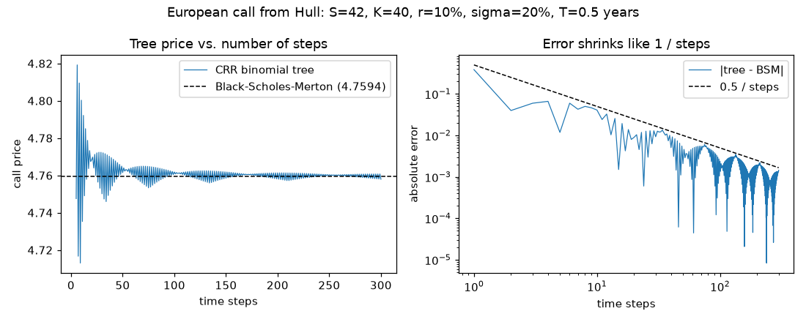
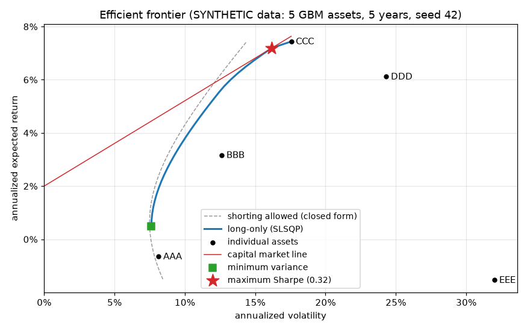
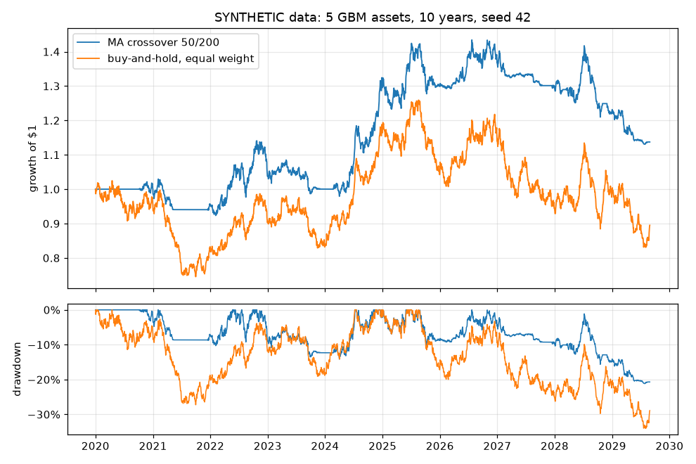
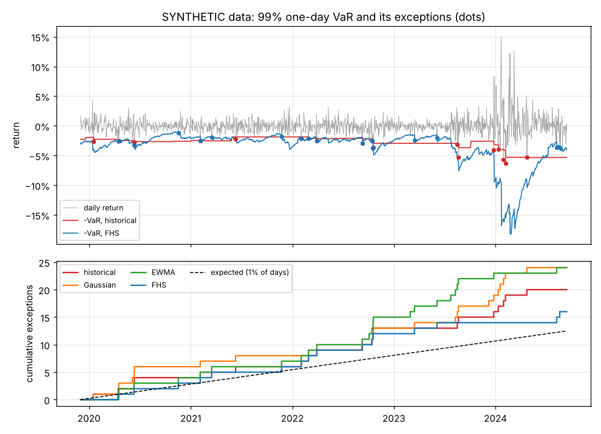

# Examples and figures

The scripts in [`examples/`](../examples) regenerate the figures and tables below with
`uv run python examples/<name>.py`. All of them use synthetic prices from seeded
simulations, so the numbers repeat from run to run. The walk-forward example writes CSVs
instead of a figure.

## Binomial convergence

Script: [`binomial_convergence.py`](../examples/binomial_convergence.py).

CRR tree prices for Hull's call approach the Black–Scholes–Merton value with an error that shrinks like 1/steps, oscillating as tree nodes move relative to the strike.



## Efficient frontier

Script: [`efficient_frontier.py`](../examples/efficient_frontier.py).

The figure shows the long-only frontier from SLSQP, the unconstrained frontier from its closed form (always to the left, since removing constraints can only lower risk), the minimum-variance and maximum-Sharpe portfolios and the capital market line. The means are estimated from five years of simulated prices, so `EEE`, simulated with an 11% drift, shows a negative estimated return.



## Backtest

Script: [`backtest_trend.py`](../examples/backtest_trend.py).

A 50/200-day moving-average crossover against equal-weight buy-and-hold over ten simulated years, with 10 bps costs. On this history (seed 42) the crossover ends ahead. The script then repeats the comparison on 100 independent synthetic histories:

```text
over 100 independent synthetic histories, CAGR(MA) - CAGR(buy-and-hold): mean -3.41%, standard error 0.29%; MA crossover came out ahead in 14 of 100
```

Seed 42 happens to be one of the 14. With no trends in the data, the crossover mostly sits in cash while the assets drift upward.



## VaR backtest

Script: [`var_backtest.py`](../examples/var_backtest.py).

The returns follow a GARCH(1,1) model, whose volatility jumps after large moves, with fat-tailed Student-t shocks. Historical simulation weights a year of history equally, so its VaR (red) reacts late to the volatility burst and its exceptions cluster; filtered historical simulation (blue) rescales history by the current EWMA volatility. Over 1,250 days at 99%:

```text
                            historical    Gaussian       EWMA        FHS
exceptions                          20          24         24         16
expected                          12.5        12.5       12.5       12.5
Kupiec p                        0.0499      0.0037     0.0037     0.3403
independence p                  0.0389      0.0833     0.4815     0.5193
cond. coverage p                0.0172      0.0033     0.0115     0.5142
Basel zone (last 250 days)  yellow (5)  yellow (7)  green (2)  green (2)
Z2                               -0.79       -1.25      -1.14      -0.33
Z2 p                            0.0014      0.0002     0.0005     0.0484
```

All three exception tests reject historical simulation, and the independence test shows why: its exceptions bunch up in the volatile period. EWMA follows the volatility (independence p = 0.48) but keeps normal tails, so it has as many exceptions as the Gaussian model, 24 against 12.5 expected. FHS passes the three exception tests; Z2 still rejects it, narrowly, at 5%.



## Size and power of the backtests

Script: [`var_size_power.py`](../examples/var_size_power.py).

Each row simulates 1,000 independent paths and forecasts with a 250-day window. It then runs the 5% tests on the last 250 or 1,000 days. The script takes about 40 seconds:

```text
Share of 1,000 SYNTHETIC paths rejected by each 5% test (Monte Carlo standard error at most 1.6%)

                                                  LR_uc   LR_ind    LR_cc       Z2 exceptions
size: EWMA forecasts on returns from the EWMA model, 99%
  250 days, measured                              10.5%     1.8%     1.0%     5.1%      1.00%
  250 days, exact                                  9.5%     1.4%     1.1%     5.0%
  1,000 days, measured                             4.2%     2.2%     2.2%     4.4%      1.00%
  1,000 days, exact                                5.5%     1.8%     2.7%     5.0%
power: Gaussian forecasts, 99%
  normal returns, 250 days                         8.1%     1.3%     0.8%     5.3%      1.02%
  Student-t(4) returns, 250 days                  13.0%     1.4%     6.8%    42.2%      1.65%
  normal returns, 1,000 days                       2.2%     1.2%     0.9%     3.9%      1.05%
  Student-t(4) returns, 1,000 days                46.9%     1.9%    31.3%    87.3%      1.63%
power: Gaussian forecasts, 97.5%
  normal returns, 1,000 days                       1.2%     2.3%     2.1%     4.0%      2.57%
  Student-t(4) returns, 1,000 days                 3.4%     2.0%     3.2%    43.3%      2.70%
```

- Size: the paths are drawn from the EWMA model itself, so the forecasts are right and every rejection is a false alarm. The measured rates agree with the exact ones from `null_rejection_rates` within the Monte Carlo error, and they are not 5%. In 250 days only 2.5 exceptions are expected, and zero exceptions (8.1% likely) already fails Kupiec's test. The independence test rarely has a pair of exceptions to work with.
- Power: Student-t returns with 4 degrees of freedom have the same variance as the normal ones but fatter tails, so Gaussian VaR is too low. Exception counts catch this in only 13% of 250-day samples. Z2, which also weighs how large the tail losses are, catches it in 42% of them, and in 87% of 1,000-day samples. At 97.5% (the level of the Basel FRTB expected shortfall) the Gaussian VaR happens to have about the right number of exceptions. The count-based tests then see nothing (3.4%), while Z2 rejects 43% of samples.

## Walk-forward portfolio construction

Script: [`walk_forward_risk_parity.py`](../examples/walk_forward_risk_parity.py).

This example connects trailing-return estimation, risk-parity allocation and backtesting. Each monthly allocation uses only closes before the rebalance date. A monthly equal-weight benchmark shares the same cash warmup, dates and costs.

```bash
uv run python examples/walk_forward_risk_parity.py
```

The command exports prices, both target tables, estimation windows, net wealth and a common-period summary to `walk-forward-output/`. The [walkthrough](WALK_FORWARD.md) explains the timing, CSV fields, reproducible inputs and limitations.
